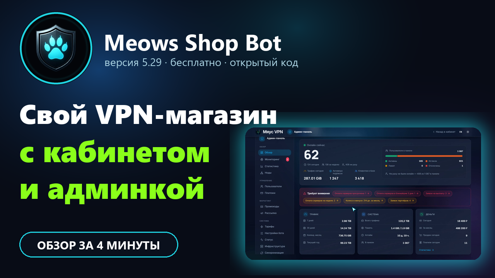
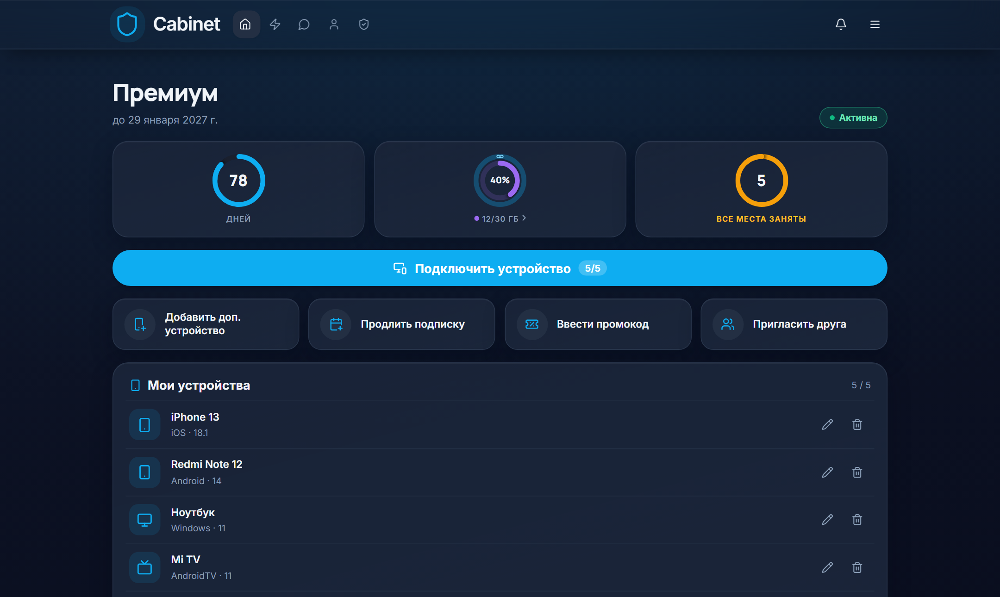
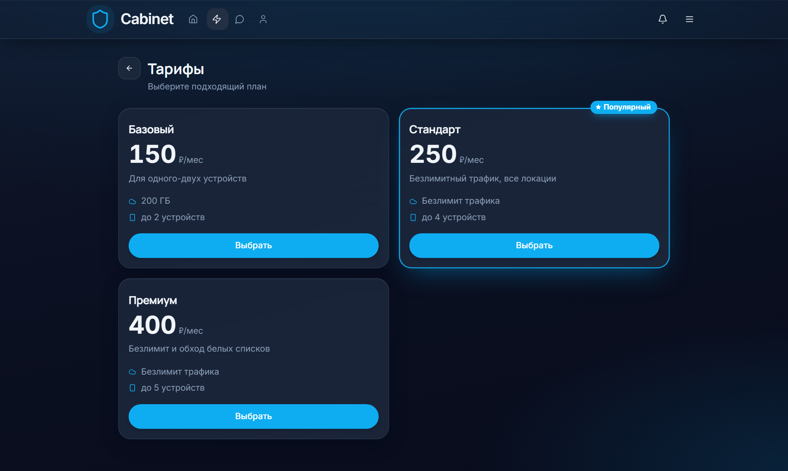
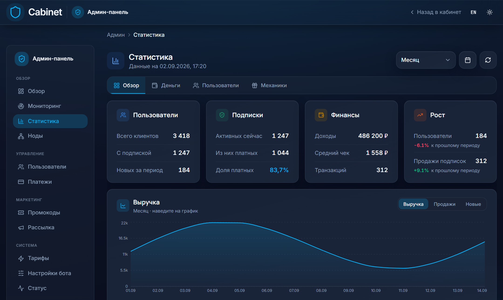
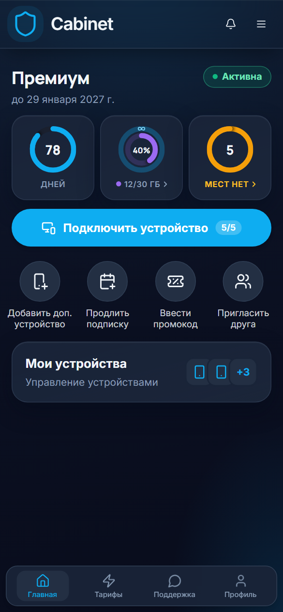

# Meows Telegram Shop

Продажа VPN-подписок через **web-кабинет и Telegram-бота**: клиент платит, продлевает и подключается в кабинете, а бот открывает его одной кнопкой (Mini App). Выдача идёт через панель [**Remnawave**](https://remna.st/).

**Канал проекта:** [Meows VPN Shop | Канал](https://t.me/meows_vpn_bot)

**Совместимость:** Remnawave `3.3.*`–`3.4.*` ↔ бот `5.x`. Панель `2.8.*` — бот `4.x` (заморожен). Полная матрица — [documentation/compatibility.md](documentation/compatibility.md).

<p align="center">
  <a href="https://www.youtube.com/watch?v=Q9VMQYXtBx0">
    
  </a>
  <br>
  <sub>▶ Видеообзор за 4 минуты — нажмите, чтобы смотреть на YouTube</sub>
</p>

<p align="center">
  
</p>

<table>
  <tr>
    <td width="50%"></td>
    <td width="50%"></td>
  </tr>
  <tr>
    <td align="center" colspan="2"></td>
  </tr>
</table>

---

## 🚀 Начать за пару минут

Два готовых сценария. Оба запускаются одной командой на сервере с Linux и Docker.

| Хочу… | Что сделать |
|-------|-------------|
| **Запустить проект с нуля** | [Автоустановщик](#-автоустановщик-бот--кабинет-одной-командой) |
| **Перейти с Bedolaga и не потерять клиентов** | [Мигратор с Bedolaga](#-переезд-с-bedolaga-одной-командой) |

### ⚡ Автоустановщик: бот + кабинет одной командой

> [!TIP]
> Проект работает в режиме **кабинета**: установщик сразу включает web-кабинет, а все кнопки бота ведут в него (Telegram Mini App). Никаких ручных правок `.env`.

```bash
bash <(curl -fsSL https://raw.githubusercontent.com/MrMe0ws/remnawave-telegram-shop/main/scripts/meows-shop-setup.sh)
```

В меню выберите **`1) Бот + Web-кабинет`**. Установщик сам:

1. клонирует проект в `/opt/remnawave-telegram-shop` и ставит последнюю релизную версию образа;
2. спросит токен бота, ваш Telegram ID и адрес панели Remnawave, сгенерирует пароль БД и секреты;
3. настроит кабинет: домен, вход через Telegram, почту (SMTP), режим меню бота `minimalism`;
4. выпустит SSL-сертификат и пропишет проксирование в nginx или Caddy, которые стоят перед панелью (или сохранит готовый блок для вашего прокси);
5. поднимет контейнеры и проверит, что кабинет отвечает.

**Что понадобится заранее:** сервер с Linux, Docker и Compose; панель Remnawave 3.3–3.4; домен с A-записью на сервер (порты 80/443 открыты); токен бота от [@BotFather](https://t.me/BotFather) и после установки `/setdomain` для этого домена; данные SMTP для писем кабинета.

Повторный запуск (обновление настроек, SSL, проверки, управление ботом):

```bash
cd /opt/remnawave-telegram-shop && ./scripts/meows-shop-setup.sh
```

Остальные пункты меню: только бот без кабинета, только кабинет, reverse-proxy/SSL, smoke-проверки, управление ботом (статус, перезапуск, обновление, логи).
Подробный разбор по шагам: [documentation/cabinet/SETUP-GUIDE-RU.md](documentation/cabinet/SETUP-GUIDE-RU.md).

### 🔄 Переезд с Bedolaga одной командой

> [!IMPORTANT]
> Мигратор переносит клиентов, сроки, тарифы, баланс, рефералов и **историю оплат** из [Bedolaga](https://github.com/BEDOLAGA-DEV/remnawave-bedolaga-telegram-bot) прямо в базу нашего бота. Панель Remnawave остаётся той же — клиентам не нужно ничего перенастраивать, ссылки подписок продолжают работать.

1. Установите проект [автоустановщиком](#-автоустановщик-бот--кабинет-одной-командой) (или убедитесь, что бот уже запущен).
2. В боте Bedolaga: админка → **«Создать бекап»** и скачайте файл `backup_….tar.gz`. Положите его на сервер.
3. **Остановите бота Bedolaga**, чтобы в старую базу не падали новые оплаты, и запустите мигратор:

```bash
cd /opt/remnawave-telegram-shop && ./scripts/meows-bedolaga-migrate.sh
```

В меню: **`1`** → источник «Бекап из админки Bedolaga», путь к файлу → **`2) Перенести всё сразу`**. Скрипт сделает пробный прогон без записи, покажет итог, сохранит копию базы бота (откат одной командой) и только потом перенесёт данные.

| Что переносится | Как |
|-----------------|-----|
| Клиенты | Telegram и вход по email/OAuth (с паролем, если он в `argon2id`), язык, username |
| Срок подписки | Из Remnawave; если юзера там нет — из Bedolaga. Остаток **баланса** → дни подписки |
| Тарифы | Названия, цены за 1/3/6/12 мес., сквады, лимиты устройств и трафика |
| Рефералы | Весь реферальный граф |
| История оплат | Покупки и продления с настоящими датами и суммами — клиенты не превращаются в «триал» |

Go на сервере не нужен: движок собирается и запускается в Docker. Поддерживаются Bedolaga 3.x и 4.x, бэкап из админки и обычный `pg_dump`.
Что именно переносится, коды отчёта и ручной запуск: [documentation/bedolaga-migration.md](documentation/bedolaga-migration.md).

---

## Что умеет проект

- **Web-кабинет и Mini App в Telegram:** регистрация (Telegram, email, Google, Яндекс, VK), покупка и продление, подключение устройств по QR и ссылке, профиль, FAQ и гайд по установке приложений
- **Тарифы:** несколько тарифов, периоды 1/3/6/12 месяцев, раздельный трафик (обычные серверы и обход) с докупкой пакетов, нашивка «Популярный»
- **Устройства (HWID):** управление, докупка мест, закрепление лимита
- **Оплаты:** YooKassa (отдельные кнопки СБП, карта и т. д.), Platega по способам, CryptoPay, Heleket, Telegram Stars; промокоды, рефералы, программа лояльности, партнёрская программа с выплатами
- **Админка в кабинете и в Telegram:** пользователи с историей действий, статистика и платежи, мониторинг событий, ноды панели, рассылки в Telegram и в кабинет, оповещения админу, настройки без перезапуска
- **Статус серверов:** публичная страница с проверкой из мира и России, в том числе для серверов обхода
- **Поддержка и уведомления:** чат поддержки с картинками, колокольчик и push в браузер, напоминания «подписка скоро закончится» и lifecycle
- **Оформление:** своё название и логотип, светлая и тёмная темы, лендинг, сезонные декор-темы, PWA
- **Колесо фортуны**, вибрация на телефоне, вход без пароля через Telegram

Полная история изменений — [CHANGELOG.md](CHANGELOG.md), подробности по темам — папка [documentation/](documentation/).

---

## Другие способы установки

Нужны **Linux**, **Docker** и **Docker Compose**.

### Ручная установка

```bash
git clone https://github.com/MrMe0ws/remnawave-telegram-shop.git
cd remnawave-telegram-shop
cp .env.sample .env
# отредактируйте .env — см. блок ниже и documentation/env.md
docker compose up -d
```

После смены `.env` пересоздайте контейнер: `docker compose up -d --force-recreate`.
Чтобы кнопки бота вели в кабинет, включите `CABINET_ENABLED=true` и оставьте `CABINET_TELEGRAM_UI_MODE=minimalism` (значения по умолчанию в `.env.sample`), а также задайте `CABINET_PUBLIC_URL`, `CABINET_JWT_SECRET` и вход через Telegram — пошагово: [documentation/cabinet/SETUP-GUIDE-RU.md](documentation/cabinet/SETUP-GUIDE-RU.md).

---

## Что обязательно указать в `.env`

Установщик спросит главное сам. Если правите файл вручную — минимум:

| Переменная | Зачем |
|------------|--------|
| `TELEGRAM_TOKEN` | Токен бота от [@BotFather](https://t.me/BotFather) |
| `REMNAWAVE_URL`, `REMNAWAVE_TOKEN` | Адрес и токен панели Remnawave |
| `DATABASE_URL` или `POSTGRES_*` | База PostgreSQL |
| `ADMIN_TELEGRAM_ID` | Ваш числовой Telegram ID (несколько — через запятую) — доступ в админку |
| `HEALTH_CHECK_PORT` | Порт сервиса (проверка «жив ли бот», кабинет, уведомления от платёжек) |
| `CABINET_ENABLED`, `CABINET_PUBLIC_URL`, `CABINET_JWT_SECRET` | Web-кабинет (ставятся установщиком) |

Оплаты включаются флагами вроде `YOOKASA_ENABLED`, `PLATEGA_ENABLED`, `TELEGRAM_STARS_ENABLED` — заполните ключи только для тех способов, которыми пользуетесь.

**Полный список переменных с пояснениями:** [documentation/env.md](documentation/env.md)  
Шаблон с комментариями: [`.env.sample`](.env.sample)

Тарифы и цены: [documentation/sales-modes.md](documentation/sales-modes.md)

---

## Документация

| Тема | Файл |
|------|------|
| Оглавление | [documentation/README.md](documentation/README.md) |
| Запуск кабинета с нуля | [documentation/cabinet/SETUP-GUIDE-RU.md](documentation/cabinet/SETUP-GUIDE-RU.md) |
| Переезд с Bedolaga | [documentation/bedolaga-migration.md](documentation/bedolaga-migration.md) |
| Все переменные `.env` | [documentation/env.md](documentation/env.md) |
| Платежи и вебхуки | [documentation/payments.md](documentation/payments.md) |
| Уведомления | [documentation/notifications.md](documentation/notifications.md) |
| Тексты и кнопки | [documentation/customization.md](documentation/customization.md) |
| Статус серверов | [documentation/cabinet/server-status.md](documentation/cabinet/server-status.md) |
| Обновление | [documentation/updating.md](documentation/updating.md) |
| Резервное копирование | [documentation/backup.md](documentation/backup.md) |
| Кабинет (всё остальное) | [documentation/cabinet/](documentation/cabinet/) |

---

## Обновление

```bash
cd /opt/remnawave-telegram-shop
git pull   # тексты бота (translations/) берутся с диска, а не из образа
docker compose pull
docker compose down && docker compose up -d
```

Подробнее: [documentation/updating.md](documentation/updating.md)

---

## Бэкапы

Своего механизма бэкапов у бота нет. Рекомендуется
[distillium/remnawave-backup-restore](https://github.com/distillium/remnawave-backup-restore) —
он бэкапит и панель Remnawave, и этого бота: база, папка проекта, расписание, отправка
в Telegram, восстановление.

В его меню выбора бота подойдёт пункт **«Бот от Иисуса»**: имена контейнера и тома
в этом форке сохранены, поэтому параметры совпадают. Версия бота значения не имеет —
скрипт снимает дамп всей базы и не разбирает её схему.

⚠️ В архив попадает `.env` со всеми секретами. Если бэкапы уходят в Telegram, учтите это
или исключите файл — подробности в [documentation/backup.md](documentation/backup.md).
